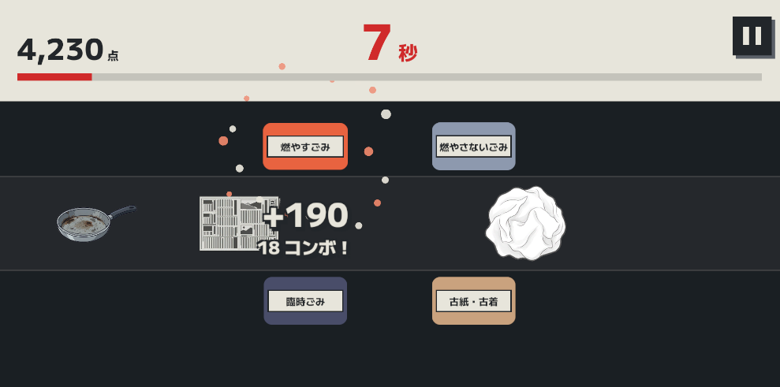
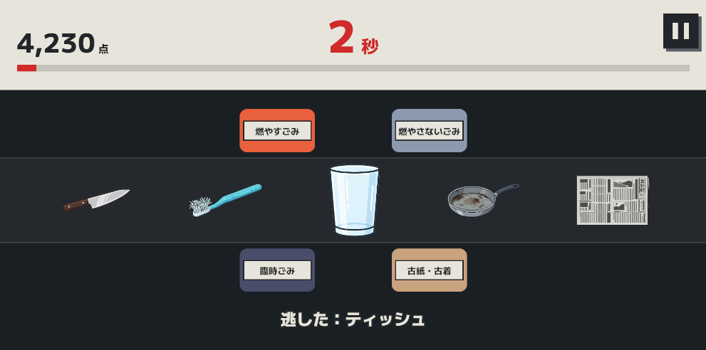
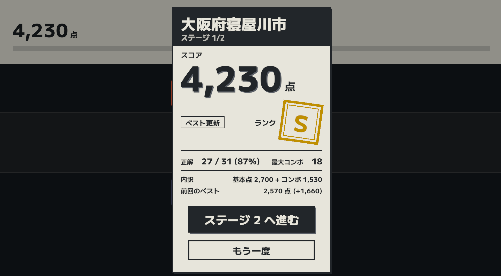

# TrashJudgement（ゴミ分別ゲーム）説明書

ベルトに乗って流れてくるゴミを、正しいゴミ箱まで運んで分別するゲームです。
キャップやラベルのように外さないといけない部品は、タップで外してから、それぞれの箱へ。
**選んだ地域の実際の分別ルールで、正解が変わります。**
住む町によってゴミの分け方が違うことを、遊びながら確かめられます。

| 読む人 | 読むところ |
|---|---|
| はじめて遊ぶ人 | 「[遊び方](#遊び方)」（1〜6番）だけ読めば遊べます |
| 点数の決まり方を知りたい人 | 「[ルールと得点のくわしい仕様](#ルールと得点のくわしい仕様)」（7〜14番）の、必要なところだけ |
| 展示でゲームを置く人 | 「[展示・運営の方へ](#展示運営の方へ)」（15〜18番）。答えを聞かれたら「答え合わせ」（14番）を |

最終更新：2026-10-30

---

# 遊び方

## 1. 60秒で、できるだけ多く正しく分ける

ページを開くと、すぐにプレイが始まります（タイトル画面はありません）。
1回のプレイは60秒です。ゴミが左から右へ流れてくるので、指で押さえて正しいゴミ箱の上まで運び、指を離します。
正解すると点が入り、続けて正解すると「コンボ」になって、1回の点が増えていきます。
60秒たつと結果発表です。得点とランク（いちばん上がS、次がA・B・C）が表示されます。

## 2. 操作

スマートフォンは指で、PCはマウスの左ボタンで、同じように操作します。

| やりたいこと | 操作 |
|---|---|
| ゴミを運ぶ | ゴミを押さえたまま動かし、ゴミ箱の上で指を離す |
| 部品を外す | 外したい部品（キャップ・ラベル・ふた）をタップ |
| 段ボールを潰す | 段ボールをタップ |
| ひと休み（一時停止） | 右上の一時停止ボタン（PCはEscキーでも） |
| 結果の演出を飛ばす | 結果画面の背景をタップ |

* 指で押さえている間、そのゴミは止まります。あわてずに部品を外せます。
* ゴミ箱の外で指を離すと、ゴミはベルトに戻ります。減点はありません。
* どの箱に入れたかは、指を離した場所で決まります。運んでいる間、指の下のゴミ箱が少し大きくなります。

## 3. 画面の見かた

| 場所 | 表示 |
|---|---|
| 左上 | 得点。点が入ると数字が跳ねます |
| 上の中央 | 残り時間（秒）。10秒を切ると赤くなります。その下の棒も残り時間です |
| 右上 | 一時停止ボタン |
| ベルトの上下 | ゴミ箱。名札に、入れるゴミの種類が書いてあります |
| 真ん中の帯 | ベルト。ゴミが左から右へ流れます |
| 入れた箱のそば | 正解すると、得点とコンボ数（「+190」「18 コンボ！」など）が出ます |

プレイの始めには、遊んでいる地域とステージが表示されます（一時停止画面でも確認できます）。

画面の下には「地域」「ステージ」ボタンがあります。押すと、その場で最初からやり直しになります。

## 4. 部品を外そう

ペットボトルのキャップとラベルは、どの地域でも外して出す決まりです。魚の空き缶のふたは、寝屋川市では外して出します。

1. 部品をタップすると、その部品だけが外れて、別のゴミになります。
2. 本体も、外した部品も、それぞれ正しい箱に入れます。

大阪市では、段ボールもタップして潰してから入れます。

> **正しい箱に入れても、外すべき部品が付いたままだと不正解**です。
> 外した部品を入れ忘れて流してしまうと「取り逃し」になります。

## 5. 間違えても、入れ直せる

違う箱に入れたり、部品を外し忘れたりすると、ゴミ箱がぶるっと震えて、ゴミがベルトに戻ってきます。もう一度入れ直せます。
ゴミの上には、次のヒントが表示されます。

| 表示 | 意味 |
|---|---|
| × 正解は ○○ | 箱が違います。○○に入れましょう |
| △ ○○ をタップして外そう | 部品が付いたままです。光っている部品をタップ |
| △ タップして潰そう | 潰してから入れる決まりです。段ボールをタップ |
| 逃した：○○ | 入れる前に、ベルトの端まで流れてしまいました |

## 6. 結果画面

* 地域とステージ、得点（スコア）、ランクのはんこ
* はじめての記録なら「初記録」、自己ベストを超えたら「ベスト更新」
* 正解数と正解率、最大コンボ
* 内訳（基本点 + コンボ）と、前回のベストとの差
* Sでないときは、次のランクまであと何点か
* 「ステージNへ進む」：次のステージがあるときに出ます
* 「もう一度」：同じ地域・ステージでもう一度

## 遊ぶコツ

* 間違えると正解の箱が出るので、覚えていきましょう。
* 地域が変わると、行き先が変わるゴミがあります（たとえばスプレー缶・歯ブラシ・フライパン）。
* 外した部品の入れ忘れに注意。コンボが切れてしまいます。
* 始まってから20秒と40秒で「ペースアップ！」と出て、後半ほど流れが速くなります。

## ことばの意味

| ことば | 意味 |
|---|---|
| コンボ | 続けて正解した数。間違えたり取り逃したりすると0に戻ります |
| 取り逃し | 箱に入れる前に、ゴミがベルトの端まで流れてしまうこと |
| 地域 | 分別ルールのもとにした市。いまは寝屋川市と大阪市 |
| ステージ | ゴミ箱が多い地域を、箱の組み合わせで分けたもの |
| ランク | 結果の評価。S・A・B・Cの順に高い |

---

# ルールと得点のくわしい仕様

1〜6番に出てきた、流れの速さ・正解の条件・得点・ランクの決まりを、数字でまとめます。

## 7. 20秒ごとに流れが速くなる

| 始まってから | 次のゴミが出るまで | 流れの速さ |
|---|---|---|
| 0〜20秒 | 2.2秒ごと | ふつう |
| 20〜40秒（ペースアップ） | 1.8秒ごと | 速い |
| 40〜60秒（ペースアップ） | 1.4秒ごと | とても速い |

出てくるゴミは毎回ランダムですが、同じゴミが2回続けて出ることはありません。
ゴミの種類によって出やすさも違い、ティッシュとお菓子のごみは出やすく、ライターは出にくくなっています。

## 8. 正しい箱に、決まりどおりの形で入れれば正解

1. その地域のルールで決まっている、正しい箱に入れたこと
2. その地域で必ず外す部品が、もう付いていないこと
3. 潰す決まりのあるもの（大阪市の段ボール）を、潰してあること

外す決まりのない部品は、付けたままでも大丈夫です（本体を正しい箱に入れれば正解です）。

## 9. 正解1回100点、コンボが続くと最大190点

正解1回の得点は、基本の100点にコンボボーナスを足したものです。
コンボが1つ増えるごとに、得点は10点ずつ上がります。10コンボ目からは、1回190点のまま変わりません。
間違えても減点はありません。

| コンボ | 1 | 2 | 3 | 4 | 5 | 6 | 7 | 8 | 9 | 10〜 |
|---|---|---|---|---|---|---|---|---|---|---|
| 1回の得点 | 100 | 110 | 120 | 130 | 140 | 150 | 160 | 170 | 180 | 190 |

間違えたり取り逃したりすると、コンボは0に戻ります。
結果画面の「正解 27 / 31」は「正解した数 / 判定の回数」です。判定の回数には、間違えて入れ直した回と、取り逃したゴミも1回ずつ数えます。

## 10. ランクは、取れた点の割合で決まる

基準は「判定の回数ぶん、コンボを切らさずに全部正解したときの点数」です。その何%を取れたかで、ランクが決まります。

| ランク | 条件 | はんこの色 |
|---|---|---|
| S | 70%以上 | 金 |
| A | 50%以上 | 赤 |
| B | 30%以上 | 青 |
| C | 30%未満 | 緑 |

1つも間違えず、取り逃しもなければ、必ずSになり「全問正解」と表示されます。
目安として、35個流れてきて、間違いが3回まで（入れ直して正解した場合）ならSです。

## 11. 遊べるのは寝屋川市と大阪市

| 地域 | ゴミ箱 | ステージ |
|---|---|---|
| 大阪府寝屋川市 | 燃やすごみ、燃やさないごみ、廃プラ・ペット、缶・びん、古紙・古着、拠点回収、臨時ごみ | 2（4箱ずつ。燃やさないごみは両方に出ます） |
| 大阪府大阪市 | 普通ごみ、プラスチック資源、資源ごみ、古紙・衣類、粗大ごみ | 1 |

* 分別ルールは、各市の公式の資料をもとにしています。
* ゴミ箱が多い地域は、いくつかのステージに分かれます。各ステージには、そのステージの箱だけで分けきれるゴミが出てきます。
* 地域とステージの切り替えは、画面下のボタンで行います（3番）。

## 12. 出てくるゴミは15種類

「（外せる）」と書いた部品は、タップで外せます。

| ゴミ | 部品 |
|---|---|
| ペットボトル 500ml | 本体、キャップ（外せる）、ラベル（外せる） |
| 魚の空き缶 | 本体、ふた（外せる） |
| 段ボール | 本体（タップで潰せる） |
| アルミ缶、生ごみ、ティッシュ、新聞、スプレー缶、フライパン、卵の殻、包丁、コップ、お菓子のごみ、歯ブラシ、使い捨てライター | 本体のみ |

## 13. 一時停止と設定

右上の一時停止ボタン（PCはEscキー）を押すと、時間とベルトが止まります。一時停止画面には、下のメニューのほかに、遊んでいる地域とステージが表示されます。

| メニュー | 内容 |
|---|---|
| 再開 | プレイに戻る |
| 設定 | 音量（全体・ゲーム内効果音・UI効果音・BGM、0〜100）。いまのバージョンでは音は出ません（17番） |
| ゲームを中断する | 確認のあと、同じ地域・ステージを最初からやり直す（そのプレイの得点は記録されません） |

## 14. 答え合わせ

地域ごとの正解（ネタバレ注意・スタッフ向け）

| ゴミ | 寝屋川市 | 大阪市 |
|---|---|---|
| ペットボトル | 本体、キャップ、ラベルとも廃プラ・ペット 外す：キャップ、ラベル | 本体：資源ごみ キャップ、ラベル：プラスチック資源 外す：キャップ、ラベル |
| アルミ缶 | 缶・びん | 資源ごみ |
| 生ごみ、ティッシュ、卵の殻 | 燃やすごみ | 普通ごみ |
| 魚の空き缶 | 本体：缶・びん ふた：燃やさないごみ 外す：ふた | 資源ごみ（ふたも同じ） |
| 新聞 | 古紙・古着 | 古紙・衣類 |
| スプレー缶 | 拠点回収 | 資源ごみ |
| フライパン | 燃やさないごみ | 資源ごみ |
| 包丁 | 燃やさないごみ | 普通ごみ |
| コップ（ガラス） | 燃やさないごみ | 普通ごみ |
| お菓子のごみ | 廃プラ・ペット | プラスチック資源 |
| 歯ブラシ | 燃やすごみ | プラスチック資源 |
| 段ボール | 古紙・古着 | 古紙・衣類 必ず潰す |
| 使い捨てライター | 燃やさないごみ | 普通ごみ |

---

# 展示・運営の方へ

## 15. ブラウザがあれば動く（インストール不要）

| 項目 | 内容 |
|---|---|
| 公開ページ | https://campus-hackathon-mms.github.io/TrashGameWeb/ |
| 端末 | スマートフォン・タブレット（縦持ち推奨）、またはPC |
| ブラウザ | Safari（iPhone、iPad）、Chrome、Edgeなどの最新版 |
| アプリのインストール | 不要（ブラウザで公開ページを開くだけ） |
| ネットワーク | 読み込むときに必要です。開場前に一度開いて、読み込みが終わるのを確かめておいてください |
| 人数 | 1台で1人 |
| 1人あたりの時間 | 1プレイ60秒と結果画面。説明を含めて、1人2〜3分を見込んでおくと余裕をもって回せます |

* PCでは、ブラウザの全画面表示（WindowsはF11キー、Macはcontrol + command + F）を使うと見やすくなります。縦長の画面を想定したゲームなので、横長の画面ではゴミ箱が中央に寄って表示されます。
* **ページを開くとすぐにプレイが始まります**（タイトル画面はありません）。来場者に渡す前に一時停止しておくと、落ち着いて説明できます。

## 16. 来場者が替わったときの操作

* 最初からやり直す：右上の一時停止ボタン →「ゲームを中断する」→「中断する」。中断するとすぐに次のプレイが始まるので、必要ならもう一度一時停止しておきます。結果画面からなら「もう一度」を押します。
* 記録を消す：自己ベストは、そのブラウザに地域・ステージごとに保存されます。ブラウザの設定から、このサイトのデータ（Cookieとサイトデータ）を削除すると、自己ベストと音量の設定が消えます。
* 地域を変える：画面下の「地域」ボタン（11番）を押すたびに、次の地域に変わります。

## 17. いまは音が出ない（故障ではない）

音が出ないのは、**いまのバージョンに効果音とBGMがまだ入っていない**ためです。

音が入ったあとは、iPhoneのSafariでは、最初に画面に触れるまで音が出ない見込みです。消音スイッチ（マナーモード）の影響を受けることもあります。

## 18. 困ったとき

| 症状 | 対処 |
|---|---|
| 画面が真っ白・読み込みが終わらない | ネットワークを確認して、ページを再読み込み |
| 動きが重い | ほかのタブやアプリを閉じる。ページを再読み込み |
| 画面が横向きで見づらい | 端末を縦持ちにする（画面の回転ロックを確認） |

---

使用フォント（どちらも [SIL Open Font License 1.1](https://openfontlicense.org)）

* BIZ UDPゴシック：Copyright 2022 The BIZ UDGothic Project Authors (https://github.com/googlefonts/morisawa-biz-ud-mincho)
* M PLUS 1：Copyright 2021 The M+ FONTS Project Authors (https://github.com/coz-m/MPLUS_FONTS)

© TeamMMS
